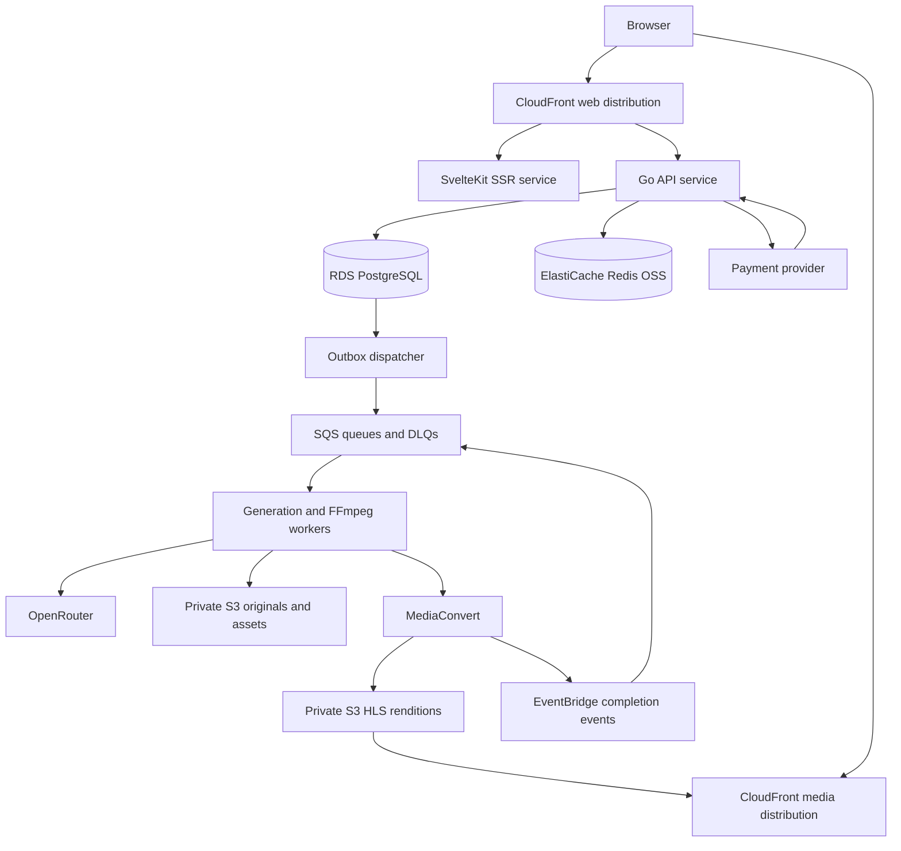

# Current decision amendment

The user subsequently chose one platform-wide Premium subscription, like Medium, replacing per-channel subscription pricing described below. Premium grants viewing access across creators; generation credits remain separate and creator payouts use the capped approved platform-revenue pool. The original VideoFlow canvas/sidebar design is preserved, with shadcn login-02/signup-02 layouts. See [Premium implementation](../../PREMIUM.md) and [UI/Premium execution record](../plans/2026-10-15-original-ui-premium.md). Historical design sections below remain context, not authority for new channel subscriptions.

# VideoFlow Cloud SaaS Platform Specification

Date: 2026-10-15
Status: Architecture accepted for implementation. Delivered coverage and remaining work are tracked in [implementation status](../../CLOUD-IMPLEMENTATION.md).
Scope: Product architecture, repository separation, AWS deployment, data ownership, Redis usage, and phased delivery.

## 1. Intent and agreed constraints

VideoFlow becomes a browser-based AI video studio and publishing platform. Creators purchase platform credits, create videos, publish to channels, attract viewers, and earn through paid memberships and a capped engagement rewards pool. The platform controls models and earns a margin on generation and memberships.

Agreed requirements:

- Separate frontend and backend repositories.
- Host the backend and video infrastructure on AWS.
- Use S3, MediaConvert, and CloudFront for video on demand.
- Do not use Cognito. Application-owned accounts and sessions live in the Go backend and PostgreSQL.
- Target a global audience; enable payments and creator payouts only in supported jurisdictions.
- Initial infrastructure budget: US$500–2,000 per month, excluding AI provider spend, payment fees, creator payouts, taxes, and engineering labour.
- Users purchase credits from VideoFlow. They neither supply provider keys nor select models.
- Prefer the cheapest eligible OpenRouter model for each operation; enforce capability and spending requirements.
- Fund engagement rewards from a capped share of eligible platform revenue.
- Preserve private creation, public profiles, publishing controls, discovery, free follows, paid creator memberships, and eventual personalized recommendations.

Assumptions proposed by this specification, rather than confirmed commercial terms:

- One primary AWS region at launch; Singapore is the cost-planning baseline. Global delivery uses CloudFront.
- One personal workspace and one creator channel per user initially; collaboration and organization billing are later work.
- Video on demand is in scope. Live broadcasting is not part of the initial implementation.
- Email/password accounts initially; optional Google sign-in follows without changing the internal user identity.
- Membership sales and cash payouts launch after paid creation and publishing are stable.

## 2. Current repository and required changes

Observed implementation anchors:

| Current location | Current behaviour | SaaS requirement |
| --- | --- | --- |
| `frontend/` | SvelteKit static SPA | Extract frontend; server-render public watch/channel pages |
| `frontend/src/lib/api.ts` | Handwritten HTTP client and local storage URL mapping | Generated versioned client, authenticated requests, server-returned asset URLs |
| `internal/api/router.go` | Application routes, local `/storage`, settings and health model details | Authentication, ownership, authorization, separate admin surface, private media |
| `internal/api/projects.go` | Global active-project lookup and activation | Explicit workspace/project IDs; active project only a per-user preference |
| `internal/db/db.go` | SQLite schema and persistence | PostgreSQL migrations, ownership, financial constraints and transactions |
| `internal/jobs/worker.go` | In-process channel queue and render recovery | Durable SQS delivery, database leases, separate workers and bounded retries |
| `internal/events/broker.go`, `internal/api/events.go` | Process-local global fan-out | Authorized, scoped events with cross-instance fan-out and durable resynchronization |
| `internal/config/`, `internal/routing/`, `internal/providers/` | Configurable provider credentials and models | Server-owned secrets and administrator-controlled policy |
| `deploy/`, `compose.yml` | Local frontend/backend containers with persistent volume | Independent cloud deployments, managed storage and infrastructure as code |
| `electron/`, desktop packaging scripts | Bundled desktop distribution | Preserve existing release lineage; exclude from SaaS deployment |

Repository extraction alone does not make the current application safe for multiple users. Ownership, payment correctness, private assets, event isolation, and durable jobs are launch prerequisites.

## 3. Product vocabulary and boundaries

| Term | Meaning |
| --- | --- |
| User | A person with a platform identity |
| Workspace | Ownership and authorization boundary for private studio resources |
| Project | Editable studio material: scripts, characters, scenes, shots, assets, and renders |
| Generation job | A paid operation with a quoted price, reserved credits, stages, and provider attempts |
| Render output | An immutable generated/exported media artifact |
| Published video | A channel publication pointing to a specific output and playback version |
| Channel | A creator's public identity and publication collection |
| Follow | Free channel subscription; grants no paid content access |
| Creator membership | Paid recurring subscription granting channel-specific benefits |
| Platform plan | Optional VideoFlow subscription with studio benefits or credit grants |
| Credit | Non-withdrawable unit used to purchase platform operations |
| Creator earning | Money payable to an eligible creator, separate from credits |
| Qualified engagement | Validated viewing activity eligible for the rewards calculation |

Published videos are independent of editable projects. Editing a project never silently changes the published version. Publishing a replacement requires explicit action and a new media version.

## 4. Repository design and ownership

### 4.1 `videoflow-web`

Own SvelteKit UI, SSR public pages, studio canvas/editor, account pages, purchases, memberships, creator analytics, and administration screens. Use adapter-node on ECS/Fargate for SSR. Deliver cacheable frontend assets through CloudFront.

The frontend contains no provider secrets, payment authority, balance calculations, or model routing. Route visibility is a usability concern; the API always enforces permission.

### 4.2 `videoflow-api`

Own the Go modular backend, workers, schema migrations, API contract, and AWS infrastructure as code. Initial proposed layout:

```text
cmd/api/                 HTTP API and authenticated SSE
cmd/worker/              SQS generation/assembly consumers
cmd/dispatcher/          Outbox delivery and scheduled reconciliation
internal/identity/      Users, credentials, sessions and recovery
internal/workspaces/    Ownership and project access
internal/billing/       Payments, credits, quotes and reservations
internal/generation/    Orchestration, model policy and provider attempts
internal/media/         Assembly, S3 assets, encoding and playback grants
internal/publishing/    Channels, publications and access settings
internal/memberships/   Subscription state and entitlements
internal/discovery/     Search, feeds and ranking
internal/analytics/     Watch ingestion and qualified engagement
internal/earnings/      Revenue allocation, balances and payouts
internal/moderation/    Reports, enforcement and appeals
internal/platform/      PostgreSQL, Redis, SQS, observability adapters
api/openapi.yaml        Versioned public API contract
infra/                  Terraform modules and environment configuration
```

Retain and adapt existing domain code where useful; the layout is a migration target, not authorization for unrelated rewrites.

API, workers, and dispatcher deploy separately from the same repository. There is no separate custom streaming server or streaming repository at launch.

### 4.3 Contract and extraction

1. Record a working creation/export baseline and API inventory.
2. Establish `/v1` routes, error schema, ownership rules, and OpenAPI contract.
3. Extract `frontend/` with its history into `videoflow-web`; publish a generated TypeScript client from backend CI.
4. Keep backend, migrations, workers, and infrastructure in `videoflow-api`.
5. Give each repo independent CI, image builds, staging deployments, and release versions.
6. Validate old frontend/new API and new frontend/old API combinations during compatible rollouts.
7. Preserve desktop packaging on its existing branch/repository until a separate desktop maintenance decision is made. Do not delete existing distribution paths as part of extraction.

Use expand/contract database migrations and additive contract changes. Generated clients use explicit versions; the frontend does not depend on the backend repository filesystem.

## 5. AWS topology



Services and controls:

- ECS/Fargate services for API and SSR; independently scaled workers with explicit maximum concurrency.
- RDS PostgreSQL in private subnets, encrypted with automated backups and point-in-time recovery.
- ElastiCache Redis OSS in private subnets, TLS and authentication enabled; no public endpoint. ElastiCache Valkey is a compatible alternative to evaluate by benchmark and quote before provisioning; it is not silently substituted.
- SQS Standard queues separated by generation, assembly, encoding events, and analytics; each has a dead-letter queue.
- Separate private S3 buckets or equivalent enforced policy boundaries for originals, playback, and analytics archives.
- MediaConvert generates playback renditions only for publications, not every intermediate draft.
- CloudFront media origin access control prevents direct public S3 access.
- EventBridge delivers encoding status to an idempotent consumer. A reconciler checks jobs whose completion events are missing.
- Secrets Manager and KMS for provider/payment credentials and signing keys; ECS task roles grant least privilege.
- SES or equivalent email delivery for account verification, recovery, and transactional notifications.
- ECR, CloudWatch, ACM, DNS, load balancing, network endpoints/NAT, and backup storage are included in infrastructure planning.

API and SSR may share an Application Load Balancer with separate target groups initially. Keep media delivery on its own distribution and hostname. No video segments pass through the API.

Use a single primary region first. A global audience does not imply multi-region database writes. Region selection must consider target users, provider access, costs, and applicable data residency requirements.

## 6. PostgreSQL, Redis, SQS and S3 responsibilities

### 6.1 Authority rule

PostgreSQL owns durable business facts. Redis owns disposable acceleration and short-lived coordination. SQS transports work. S3 stores large immutable objects. Loss of Redis must never lose purchased credits, create earnings, grant membership, or erase a job.

### 6.2 Redis decision matrix

| Feature | PostgreSQL or durable owner | Redis use | Expiry / failure behaviour |
| --- | --- | --- | --- |
| Users, password hashes, recovery records | PostgreSQL | None required | Authentication fails closed if database unavailable |
| Sessions and revocation | PostgreSQL | Optional hints only; never bypass durable revocation | Validate durable session on authenticated requests initially |
| Login, recovery and API rate limits | Durable account security state + edge controls | Shared atomic counters/token buckets | Login 15-minute windows; Redis outage uses conservative per-instance limits plus durable lockout |
| Generation admission rate | PostgreSQL reservations and quota rows | Per-user request throttles | Fail closed for new paid submissions if shared admission limiter unavailable |
| Credits, payments, refunds, earnings | PostgreSQL ledgers | Never authoritative; avoid balance cache at launch | Read current balance from database |
| Paid membership/playback permission | PostgreSQL | No positive entitlement cache at launch | Recheck database before each new playback grant |
| Published video/channel metadata | PostgreSQL | Cache public metadata by version | 60-second TTL, invalidation after commits; database fallback |
| Public feeds and trending candidates | PostgreSQL aggregates / S3 events | Cached ID lists and sorted sets | 5-minute TTL; chronological database fallback |
| Personalized recommendations | PostgreSQL durable signals | Per-user candidate list | 5-minute TTL; followed/recent feed fallback |
| Search | PostgreSQL full-text indexes initially | Optional public result cache | 60-second TTL; database fallback |
| Presence / online viewers | Non-financial, approximate | Heartbeats and expiring sets | 60-second TTL; unavailable during outage |
| Live job progress fan-out | PostgreSQL job events | Pub/Sub scoped by workspace and job | Best-effort hints; reconnect reads durable state |
| Job status / retries / leases | PostgreSQL + SQS | No correctness dependency | Database claim and fencing version required |
| Watch ingestion deduplication | Durable event ID uniqueness in processed batches | Optional 24-hour prefilter | Cache loss increases duplicate processing, not qualified earnings |
| Display view counts | PostgreSQL validated rollups | 30-second cached count | Database fallback; Redis increment alone never means a payable view |
| Daily quotas / provider concurrency | PostgreSQL transactional counters and leases | Optional optimization | Never use an expiring Redis lock as the only spend guard |
| Idempotency / webhook receipts | PostgreSQL unique constraints | Optional lookup acceleration only | Durable record decides replay result |
| Video/image files | S3 | None | Never store media bytes in Redis |

Redis is required for shared rate limiting and cross-instance fan-out in the multi-instance launch, not as a replacement database. Low-traffic local development may use adapters without Redis; production acceptance includes its outage behaviour.

### 6.3 Cache contract

- Namespace keys by environment, version, and authorization scope: `prod:v1:public:video:{id}:{version}`, `prod:v1:workspace:{id}:job:{id}`.
- Never cache private responses under public keys. Do not store secrets, raw session tokens, or unnecessary personal data in Redis.
- Use cache-aside reads, bounded payloads, TTL jitter of up to 20%, and request coalescing on hot misses.
- Commit database changes first, then invalidate via the outbox. TTL provides eventual recovery if invalidation is delayed.
- Keep abuse counters isolated from evictable content caches, using separate instances/clusters when caching is enabled at scale. Select no-eviction for the security coordination store and alert before memory saturation.
- Cache outage must not trigger unlimited database traffic: cap fallback concurrency and shed nonessential feed/analytics requests.
- Redis Pub/Sub carries IDs and versions, not durable facts. Clients resynchronize using PostgreSQL events or snapshots.
- Never rely on Redis locks for financial settlement, payouts, exactly-once provider submission, or job ownership.

## 7. Accounts, tenancy and security

- Go owns users, verified emails, password credentials, OAuth identities, sessions, and recovery. No Cognito dependency.
- Use a maintained password-hashing implementation with Argon2id and stored parameters; calibrate cost in the deployment environment.
- Store only hashes of opaque session and single-use recovery tokens. Sessions use Secure, HttpOnly cookies with explicit SameSite policy, CSRF protection, rotation, and revocation.
- Proposed session limits: 7-day idle expiry and 30-day absolute expiry. Password reset revokes existing sessions.
- Verification/recovery messages avoid account enumeration; recovery tokens expire after 30 minutes and are consumed atomically.
- Production cookies and CORS allow only configured origins. SSR forwards identity safely without caching authenticated responses publicly.
- Each private row has a workspace owner directly or through a constrained parent. Repository methods require an authorization scope; nested object IDs must belong to the same workspace.
- User role, workspace role, and platform administrator role are distinct. Administrators require MFA before billing/moderation access.
- Rate-limit sign-up, login, recovery, uploads, generation, watch events, comments, and playback grants.
- Validate uploads by size, type and content; quarantine untrusted files before media processing. Sandbox media jobs, cap resources, and restrict outbound fetch destinations to prevent SSRF.
- Authorization covers exports, imports, revisions, downloads, job logs, SSE, thumbnails, and provider result URLs, not only project endpoints.

## 8. Data model and invariants

Core proposed entities:

| Domain | Durable entities |
| --- | --- |
| Identity | users, credentials, oauth_identities, sessions, email_tokens, workspaces, workspace_members |
| Studio | projects, characters, assets, scripts, scenes, shots, revisions, render_outputs |
| Generation | quotes, jobs, job_stages, provider_attempts, job_events, quota_leases, model_policies |
| Billing | payment_customers, purchases, webhook_receipts, credit_accounts, credit_journals, credit_postings, reservations |
| Publishing | channels, videos, video_versions, encoding_jobs, publication_settings, follows |
| Memberships | membership_plans, subscriptions, entitlement_grants |
| Engagement | watch_sessions, analytics_batches, qualified_daily_rollups, viewer_preferences |
| Earnings | revenue_periods, reward_pools, earning_journals, earning_postings, payout_batches, payouts |
| Operations | outbox_events, processed_messages, moderation_cases, audit_events |

Requirements:

- Use UUID identifiers; foreign keys and unique constraints enforce ownership and idempotency relationships.
- Money uses integer minor units and an explicit currency. Credits use integer units. Never use floating point for settlement.
- Credit journals and money journals are separate, immutable and balanced within their unit/currency. Corrections use reversing entries.
- Cached account totals must reconcile to postings. Transactions lock the relevant account/aggregate before reserving or settling credits.
- Store timestamps in UTC. Use optimistic versions for mutable jobs, video settings and subscription updates.
- Financial rows are retained and pseudonymized according to the adopted retention policy rather than deleted with a project.
- Cross-domain changes use PostgreSQL transactions when possible and an outbox for asynchronous side effects.

## 9. Credits, pricing and model control

### 9.1 Model selection

An admin-managed policy chooses the cheapest eligible paid model/provider configuration for text, vision, image, and video separately. Eligibility includes required modalities, duration, resolution, reference inputs, reliability checks, commercial suitability, and a maximum operation cost.

Refresh catalog/pricing daily; record fetched time and validate candidates before activating a new policy version. If pricing is stale beyond 24 hours, new quotes use a reviewed fixed ceiling or are unavailable. Do not silently route to an unbounded fallback or a free endpoint with unsuitable limits.

Generation APIs reject model/provider/key fields from ordinary users. Remove provider secrets, connection settings, and model configuration from customer-facing APIs. Provider model identifiers are not exposed by public health endpoints.

### 9.2 Purchase and spend

1. Backend creates a credit-pack checkout using an internal product/price mapping.
2. Verified payment webhook records its unique receipt and credits the account transactionally; browser success redirects grant nothing.
3. Backend creates a quote containing operation limits, pricing/model-policy versions, credits, expiry, and a maximum provider cost.
4. Quote expires after 15 minutes. Submission uses an idempotency key and atomically reserves credits, creates the job, consumes quota, and writes an outbox event.
5. Worker executes only within the reserved quote and provider cost ceiling.
6. Successful stage checkpoints and final settlement are durable. Final charge never exceeds the accepted quote without a new explicit purchase decision.
7. Technical failure releases unused reserved credits; this proposed launch policy refunds failed paid stages even where provider charges are unrecoverable. Track that cost as platform loss.
8. Cancellation stops unstarted stages; completed, disclosed billable stages remain charged. An ambiguous provider submission remains pending reconciliation rather than automatically submitted again.

Quote pricing must include expected provider charges, retry allowance, assembly, encoding, storage allowance, payment costs and target margin. Purchase prices are public; underlying provider prices remain administrative.

Provider attempts record request fingerprints, policy/model IDs, estimated and actual costs, provider job IDs, and submission state. A timeout after submission is not proof of failure. If provider idempotency or lookup is unavailable, hold the attempt for reconciliation/manual resolution instead of creating duplicate spend.

Refunds and chargebacks reverse grants under a defined policy. Already consumed credits can create an account debt/restriction; immutable history is preserved. Monthly platform-plan grants use the same ledger and renewal idempotency rules.

## 10. Durable jobs and events

Generation lifecycle:

```text
quoted -> reserved -> queued -> running -> succeeded
                                  |          |
                                  +-> failed +-> credit settlement
                                  +-> cancel_requested -> cancelled
                                  +-> reconciliation_required
```

- PostgreSQL owns stage and attempt state. SQS messages contain identifiers and schema versions, not secrets or mutable business authority.
- Transactional outbox avoids committing a credit reservation without eventual queue delivery. Dispatcher retries use durable message IDs.
- Workers claim a database lease using compare-and-swap and a monotonically increasing fencing version; stale workers cannot finalize a newer attempt.
- Extend SQS visibility during active work. Duplicate messages are expected; processing is idempotent and side effects use durable uniqueness/provider identifiers.
- Separate provider submission, scheduled polling, media downloads, assembly, and encoding; do not keep a worker sleeping for the whole provider generation duration.
- Retry transient internal work at most five times with exponential backoff and jitter. Paid provider resubmission is governed separately by quote limits and reconciliation.
- SQS queues use 14-day retention and DLQs after five receives; production queue settings must account for long-running assembly and visibility extension.
- A scheduled reconciler finds expired leases, undelivered outbox rows, abandoned reservations, and encoding/provider attempts without terminal results.
- SSE authenticates and filters by workspace and job. Persist monotonically ordered job events; retain detailed progress for 7 days, then serve a terminal snapshot. `Last-Event-ID` replay or a snapshot restores state after reconnect.
- Redis fan-out accelerates notifications; dropped notifications never change the recorded job outcome.

## 11. Storage, assembly and streaming

### 11.1 Media lifecycle

1. Upload to a workspace-scoped private S3 object using a short-lived upload grant and declared size/type limits.
2. Validate/quarantine, then register the asset in PostgreSQL.
3. Workers save generated clips and assembled immutable outputs to S3, recording checksums, sizes and ownership.
4. Explicit publication creates a video version and encoding job using an outbox event.
5. MediaConvert creates HLS 480p, 720p, and 1080p H.264 renditions at up to 30 fps; never upscale beyond the source. Use four-second segments and AAC audio in the initial profile.
6. Encoding completion records the manifest and rendition metadata. The publication becomes playable only after encoding and moderation gates pass.
7. CloudFront delivers playlists, segments, captions, and thumbnails directly from protected S3 origins.

The delivery/encoding profile is versioned and benchmarked for quality, request count and price before production activation. Avoid separate audio segment requests initially if they unnecessarily increase CDN requests.

### 11.2 Access and publication controls

- Visibility: public, unlisted, private.
- Audience: free or channel-members-only; private content remains owner-authorized regardless of audience setting.
- Lifecycle: draft, processing, scheduled, published, blocked, deleted.
- Independent controls: comments enabled and public engagement counts visible.
- Private and blocked videos never enter public search, feeds, sitemaps, or public metadata caches. Unlisted videos are accessible by link subject to audience checks but excluded from discovery.
- API checks current publication state and membership in PostgreSQL before issuing a playback grant.
- Use CloudFront signed cookies scoped to the video version's path for HLS files. All media objects, not only manifests, require valid access.
- Initial grant lifetime: five minutes; refresh during viewing through the authorized grant endpoint. Revocation takes effect for new grants immediately and for existing grants within five minutes, excluding already downloaded content.
- Use `media.<platform-domain>` and a media authorization behaviour routed to the API so host-only signed cookies are issued on the correct media host. Restrict CORS to the web origin and test credentialed HLS requests in supported browsers.
- Signed playback is access control, not DRM or prevention of screen recording.
- Removal invalidates public metadata immediately, denies grants, and purges CDN objects when necessary. High-priority takedowns have an explicit invalidation path.

### 11.3 Retention defaults

- Abort incomplete multipart uploads after 24 hours.
- Worker scratch files are deleted at task completion; orphan temporary S3 uploads expire after 24 hours.
- Unselected intermediate clips expire after 30 days unless retained explicitly within a workspace quota.
- Retain selected project outputs/originals while the account's storage allowance permits; no automatic deletion of published source material without notice and policy.
- Deleted media is purged from active storage within 30 days unless subject to a lawful hold; publication access is disabled immediately.
- Enable versioning selectively for originals/configuration with bounded noncurrent-version retention; do not duplicate replaceable HLS segments through blanket version retention.
- Start S3 Standard for active assets. Introduce archive tiers only after retrieval and minimum-duration charges are evaluated.

## 12. Channels, memberships and moderation

- Channels have unique handles, profiles, banners, descriptions, video collections, and free followers.
- Public pages are server-rendered with canonical URLs, share metadata and appropriate indexing rules.
- Creator memberships grant channel-specific access. Platform plans grant studio benefits; follows grant notifications only.
- Subscription webhooks are verified, uniquely recorded, and reconciled against provider state. Out-of-order events cannot resurrect expired access.
- Default entitlement policy: access until the paid-through timestamp after cancellation; no new grants after expiry or confirmed refund/revocation. Failed renewals do not extend access beyond paid-through time.
- Membership prices, platform commission, tax handling and refund rules must be configured and published before sales open.
- Creator onboarding verifies payout eligibility before monetization is enabled. Unsupported countries may create/view content but cannot be promised earnings they cannot receive.
- Publishing includes automated checks plus a report/review workflow, copyright complaints, impersonation handling, appeals, creator sanctions and AI-generated-content disclosure.
- Comments are a later publishing enhancement with reporting, blocking and rate limits; they do not block the first publishing release.

## 13. Analytics, discovery and recommendation

- Initial feeds: followed channels, recent public videos, categories and validated trending content.
- PostgreSQL full-text search initially; add a dedicated search engine only when measured latency/index requirements justify it.
- Capture playback session IDs, video/version IDs, event sequence IDs, active playback intervals and server receipt times. Use 15-second heartbeats and an end event; cap credited time to plausible elapsed playback.
- Ingest through rate-limited endpoints into SQS; archive immutable batches to S3 and maintain PostgreSQL batch processing receipts and daily rollups.
- Client events are untrusted signals. Deduplicate durable batches/events, reconcile sampling against CDN delivery evidence, and flag automation rather than treating a heartbeat as a payable view.
- Display views can update asynchronously. Define a display view as at least 10 seconds of validated playback or 90% completion for shorter clips, at most once per viewer/video in 24 hours. Anonymous viewer identification is approximate and privacy-sensitive.
- Qualified rewards engagement excludes self-viewing, suspicious repetition, known bots, blocked content and disallowed traffic. Anonymous traffic is excluded from initial cash rewards; signed-in traffic still requires fraud checks.
- Ranking starts with completion, qualified watch time, follows, recency, topic preferences and negative feedback. Include diversity/exploration; do not rank solely by raw clicks.
- Users can hide a video/channel, choose not interested, and clear recommendation history. Public/member-only recommendation candidates still require access checks for playback.
- Retain raw analytics for 90 days initially; retain pseudonymized aggregates and financial allocation evidence under the adopted retention policy.

## 14. Creator earnings and payouts

Separate three financial flows: generation purchases, membership revenue share, and engagement rewards. Credits never become withdrawable earnings.

For each closed monthly accounting period:

```text
Eligible platform contribution = max(0,
  recognized platform revenue
  - taxes
  - refunds and chargebacks
  - payment processing costs
  - direct AI generation and media processing costs
  - creator membership revenue share
  - agreed hosting/storage/delivery allocation)

Rewards pool = min(configured monthly cap,
                   configured percentage * eligible platform contribution)

Creator allocation = rewards pool * creator qualified watch time
                     / all eligible creators' qualified watch time
```

- Reward percentage/cap default to zero until the policy is approved and published. This specification does not invent a promised commercial payout rate.
- Recognize prepaid credit revenue as credits are consumed under the adopted accounting policy; do not distribute unspent customer deposits as profit.
- If eligible watch time is zero, do not allocate the pool; no division by zero or automatic carry-forward obligation.
- Round allocations in currency minor units with a deterministic remainder method; total allocations never exceed the pool.
- Close periods from versioned durable aggregates. Corrections create auditable adjustments; rerunning a period cannot duplicate earnings.
- Membership earnings use a separately configured revenue split and are not subtracted a second time from the creator's reward allocation.
- Apply a proposed 30-day risk hold and US$50-equivalent payout threshold; these must be reviewed for country/provider compatibility before activation.
- Payouts require verified identity, supported country/currency, available settled funds, and explicit batch approval. Unique provider idempotency keys prevent duplicate transfers.
- Forecasts, pending earnings, available earnings, held amounts, and paid amounts are distinct states visible in the creator dashboard.
- Do not advertise a guaranteed payment per raw view. Publish eligibility, funding, fraud-review and adjustment policies.

## 15. API contract and frontend journeys

API uses `/v1`, cursor pagination, stable error codes, request IDs, and idempotency keys for financial/job mutations. Errors return `{code, message, request_id, details}` without secrets or provider internals.

Representative resources:

| Journey | API surface |
| --- | --- |
| Accounts | `/v1/auth/register`, `/login`, `/logout`, `/verify-email`, `/forgot-password`, `/reset-password`, `/v1/me` |
| Studio | `/v1/workspaces/{id}/projects`, project-scoped scripts/scenes/shots/assets |
| Credits | `/v1/billing/checkout`, `/v1/credits/balance`, `/v1/credits/transactions` |
| Generation | `/v1/generation/quotes`, `/v1/generation/jobs`, `/v1/jobs/{id}`, `/v1/jobs/{id}/events` |
| Publishing | `/v1/channels/{id}`, `/v1/videos`, `/v1/videos/{id}/publish`, `/v1/videos/{id}/playback-grant` |
| Community | `/v1/channels/{id}/follow`, `/v1/memberships/checkout`, `/v1/memberships` |
| Discovery | `/v1/feed`, `/v1/search`, `/v1/watch-sessions`, `/v1/watch-events` |
| Creator operations | `/v1/creator/analytics`, `/v1/creator/earnings`, `/v1/creator/payout-account` |
| Administration | `/v1/admin/model-policies`, pricing, moderation, reward periods, payout batches |
| Provider events | Verified payment webhooks; internal authenticated SQS/EventBridge consumers |

Primary UX:

1. Register and verify account; enter the studio with a private personal workspace.
2. Buy credits; display confirmed available balance and transaction history.
3. Describe video, choose creative presets, review a credit quote, and confirm generation.
4. Follow resumable progress, inspect outputs, edit and export.
5. Publish to a channel with explicit visibility/audience controls and encoding progress.
6. Viewers discover/watch/follow; eligible viewers join paid memberships.
7. Creators inspect validated analytics and earnings; eligible creators complete payout onboarding.

Frontend renders loading, empty, failure, payment-pending, quota-exceeded, moderation-blocked, and recovery states. Refreshing a page cannot lose a job or create another purchase.

## 16. Infrastructure budget and cost controls

These are planning allocations, not provider quotations:

| Category | US$500 lean target | US$2,000 growth envelope |
| --- | ---: | ---: |
| API, SSR, load balancer and networking | 120 | 300 |
| PostgreSQL and backups | 80 | 220 |
| Redis | 35 | 100 |
| Generation orchestration and FFmpeg compute | 60 | 300 |
| MediaConvert | 45 | 300 |
| S3 storage and operations | 35 | 150 |
| CloudFront | 15 | 200 |
| SQS, events, email, secrets, logs and monitoring | 40 | 130 |
| Contingency | 70 | 300 |
| Total | 500 | 2,000 |

The lean target is not a high-availability guarantee. Multi-AZ database/cache requirements and NAT/endpoints can raise the baseline; quote a concrete Terraform topology before provisioning. Production financial launch requires successful restore/failover tests for the selected topology.

Cost model inputs: stored source minutes, retained intermediate bytes, new publication minutes, rendition profiles, delivered minutes, average bitrate, HLS requests per minute, origin cache misses, worker CPU-hours, database size/IO and network traffic.

Prior comparison baseline: 10,000 stored minutes, 1,000 newly encoded minutes/month, 8 Mbps originals, three renditions, 3 Mbps average delivery. Under the selected published CloudFront plans, AWS video infrastructure was approximately $98/month at 100,000 delivered minutes or $283 at 1 million, excluding shared backend and AI spend. These are illustrative, sensitive to allowances and encoding choices, and must be recalculated before purchase.

Controls:

- Budget alerts at 50%, 75%, 90% and 100% of the selected monthly envelope. AWS budget alerts are notifications, not guaranteed hard caps.
- Independent daily provider spend ceilings, per-workspace quotas, maximum worker tasks, and encoding concurrency limits.
- Stop new generation when its funded budget is exhausted; do not stop already-authorized private playback solely because a generation budget is exhausted.
- Monitor CloudFront transfer and request allowances. Sustained excess requires plan review; do not interpret no-overage pricing as unlimited performance.
- Track cost per successful generation, published minute, stored minute and delivered minute, plus retry/refund loss and gross contribution.
- Attribute public streaming costs to platform economics; introduce published fair-use/storage quotas before promising unlimited hosting.
- Evaluate engineering/operational labour separately from provider invoices. Cloudflare Stream remains a fallback option, not part of the selected implementation.

## 17. Observability and operational requirements

- Correlate request, workspace, quote, job, provider attempt, encoding job, payment and payout identifiers without logging credentials or raw sensitive prompts by default.
- Dashboards cover queue age, DLQs, job success/latency, ambiguous provider attempts, ledger reconciliation, cache hit rate, Redis memory, playback errors and unit costs.
- Alerts cover duplicate settlement attempts, negative available balances, payout mismatches, moderation failures, backup failures, provider spend spikes and database saturation.
- Daily automated ledger/payment reconciliation; monthly payout-period reconciliation and approval.
- Backups: PostgreSQL PITR with 14-day retention initially; quarterly restore drills. Initial recovery objectives: RPO at most 15 minutes for unrecoverable database loss and RTO at most four hours, demonstrated in staging before paid launch.
- Redis restoration is not a business-data recovery dependency. Rebuild caches and live state after loss.
- Graceful API shutdown, bounded SSE reconnect, worker lease expiry and queue redelivery are tested during deployments.
- Terraform is versioned, reviewed and applied per environment. Production data is not copied into development without sanitization.
- Separate staging/production accounts or equivalent strong IAM and data isolation; no shared provider keys or customer balances.

## 18. Delivery roadmap and acceptance gates

This is a master specification. Each phase gets a bounded implementation plan and review; it is not one giant implementation task.

| Phase | Deliverables | Acceptance gate |
| --- | --- | --- |
| 0. Foundation/extraction | Contract inventory, separate repos, CI, local PostgreSQL/Redis/SQS adapters, staging Terraform | Existing creation/export baseline works across repositories; no desktop release paths removed |
| 1. Accounts and isolation | Identity, sessions, workspaces, PostgreSQL, S3 assets, scoped API/events | Cross-user access denied across CRUD, nested IDs, imports/exports, revisions, downloads and SSE |
| 2. Durable generation | SQS/outbox, leases, provider attempt reconciliation, workers, model policy | Crash/retry/duplicate delivery does not duplicate assets or unbounded provider spend |
| 3. Paid studio | Payments, credit journals, quotes, reservations, refunds, admin costs | Concurrent spends and repeated/reordered webhooks reconcile exactly; provider outage preserves balances |
| 4. Publishing | Channels, publication versions, MediaConvert, CloudFront grants, reports/moderation, initial feeds | Private/member-only segment access denied; blocked/unlisted discovery rules hold; encoding recovery works |
| 5. Memberships | Creator onboarding, recurring billing, entitlements, earnings journals | Renewal, expiry, cancellation, refund and out-of-order event tests correctly update access and earnings |
| 6. Analytics and recommendations | Durable watch batches, validated rollups, feedback, ranked feeds | Replays do not inflate qualified engagement; privacy controls and cache-loss fallback work |
| 7. Rewards and payouts | Closed revenue periods, capped allocations, holds, approved payout batches | Allocation totals respect pool; duplicate execution cannot pay twice; payout coverage verified |

First commercial release: phases 0–3. First public viewing release: phase 4. Cash rewards remain disabled until phase 7 and the applicable launch blockers are resolved.

## 19. Verification strategy

- Run existing Go tests and frontend checks/build as the baseline; add PostgreSQL integration coverage instead of assuming SQLite SQL is portable.
- Contract tests validate generated clients and compatible rolling deployments.
- Isolation tests use two users/workspaces and cover all resource and event paths, including cross-workspace parent/child substitution.
- Financial tests cover simultaneous reservations, timeout after payment/provider submission, repeated keys with different bodies, duplicate webhooks, refunds after spend, and rollback during settlement.
- Worker tests kill a process between provider submission and local persistence, before/after outbox dispatch, and during final settlement. Assert reconciliation rather than blind resubmission.
- Media tests check actual 480p/720p/1080p output where source permits, captions, audio, signed-cookie scope, expired grants, CORS, direct S3 denial and every HLS object type.
- Redis outage/flush tests assert unchanged balances/earnings, scoped SSE resynchronization, conservative rate limiting and bounded database fallback.
- Load test initial target: 100 concurrent viewers, 20 concurrent studio users and five admitted generation jobs. CDN serves segments; report API p95 under 500 ms for ordinary reads excluding provider work and exports.
- Browser acceptance covers current Chrome, Safari and Firefox, mobile playback, SSR share pages, payment refresh and progress reconnect.
- Rehearse restore, migration rollback/forward repair, moderation takedown and payout reconciliation before the relevant launch.

## 20. Decisions still requiring business input

These are explicit activation dependencies, not gaps that an implementer should guess:

1. Legal company registration country and initial payout recipient countries: payment provider approval and payout coverage depend on them.
2. Payment processor and funds-flow approval for memberships, rewards, refunds and creator payouts. Stripe is a candidate, not a guaranteed global solution.
3. Credit pack prices, target margin, platform-plan benefits and storage allowances: configuration must be approved before paid checkout is enabled.
4. Creator membership commission, reward pool percentage/cap, and final payout threshold/hold policy: default monetization switches remain off until published.
5. Final AWS region and production availability target after a concrete quote and recovery rehearsal.
6. Content policy, age policy, tax/accounting treatment, privacy/retention obligations and creator terms for the supported launch markets.

These decisions do not block repository extraction or technical design. They do block the corresponding payment, monetization, or production activation.

## 21. Sources and pricing references

Technical and pricing references checked 2026-10-15; verify rates and plan capabilities again before provisioning.

- [AWS video-on-demand delivery architecture](https://docs.aws.amazon.com/AmazonCloudFront/latest/DeveloperGuide/on-demand-streaming-video.html)
- [CloudFront pricing](https://aws.amazon.com/cloudfront/pricing/)
- [CloudFront flat-rate allowances and conditions](https://docs.aws.amazon.com/AmazonCloudFront/latest/DeveloperGuide/flat-rate-pricing-plan.html)
- [MediaConvert pricing](https://aws.amazon.com/mediaconvert/pricing/)
- [S3 pricing](https://aws.amazon.com/s3/pricing/)
- [Cloudflare Stream pricing, comparison alternative](https://developers.cloudflare.com/stream/pricing/)
- [ElastiCache engine selection](https://docs.aws.amazon.com/AmazonElastiCache/latest/dg/SelectEngine.html)
- [Redis cache-aside](https://redis.io/docs/latest/develop/use-cases/cache-aside/)
- [SQS visibility and duplicate delivery](https://docs.aws.amazon.com/AWSSimpleQueueService/latest/SQSDeveloperGuide/sqs-visibility-timeout.html)
- [CloudFront signed cookies for HLS](https://docs.aws.amazon.com/AmazonCloudFront/latest/DeveloperGuide/private-content-choosing-signed-urls-cookies.html)
- [OpenRouter video generation](https://openrouter.ai/docs/guides/overview/multimodal/video-generation)
- [Stripe Connect country and payout configuration](https://docs.stripe.com/connect)
